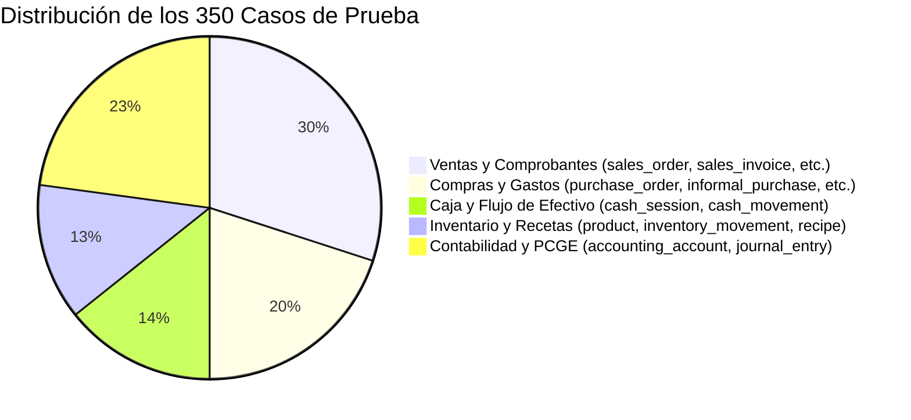

# Marco Metodológico y Banco de Casos de Prueba para Evaluación de Modelos Text-to-SQL (LoRA y Agentes)

> **Métricas Evaluadas**: Exact Match (EM), Execution Accuracy (EX), Valid Efficiency Score (VES) y Test Suite Accuracy (TS).  
> **Ámbito**: Base de datos relacional PostgreSQL de Pollería ERP (Módulos: Ventas, Compras, Caja, Inventario, Contabilidad PCGE).  
> **Población de Casos de Prueba**: 350 casos estratificados (Fácil: 100, Medio: 150, Difícil: 70, Extra Difícil: 30).

---

## 1. Definición Formal de Métricas

Para una evaluación científica y rigurosa comparable con benchmarks de la literatura (*Spider*, *BIRD*, *Test-Suite Evaluation for Text-to-SQL*), se definen formalmente las cuatro métricas clave:

### 1.1 Exact Match (EM)
Mide la coincidencia sintáctica normalizada entre la consulta generada $\hat{Q}$ y la consulta de referencia o *Gold* $Q^*$.\
- **Normalización de AST**: Se normalizan identificadores (minúsculas), orden de proyecciones independientes, eliminación de alias superfluos y estandarización de cláusulas (`JOIN ... ON`, operadores relacionales).\
- **Fórmula**:\
  $$\text{EM} = \frac{1}{N} \sum_{i=1}^{N} \mathbb{I}(\text{AST}(\hat{Q}_i) \equiv \text{AST}(Q^*_i))$$\
- **Limitación**: El SQL permite múltiples escrituras sintácticas válidas para el mismo resultado semántico (e.g. `IN (SELECT ...)` vs `EXISTS` vs `INNER JOIN`). Por ello, EM es el límite inferior y se complementa con EX y TS.

### 1.2 Execution Accuracy (EX)
Mide si la ejecución de la consulta predicha $\hat{Q}$ produce exactamente el mismo conjunto de resultados (tuplas y valores) que la consulta de referencia $Q^*$ sobre la base de datos de evaluación:\
$$\text{EX} = \frac{1}{N} \sum_{i=1}^{N} \mathbb{I}(\text{Exec}(\hat{Q}_i, \mathcal{D}) = \text{Exec}(Q^*_i, \mathcal{D}))$$\
- **Criterio de Coincidencia**: Se comparan multiconjuntos (salvo que la consulta exija explícitamente `ORDER BY`, donde el orden de las tuplas es estricto). Los tipos de coma flotante y `DECIMAL(7,2)` se comparan con tolerancia $\epsilon = 10^{-2}$.

### 1.3 Valid Efficiency Score (VES)
Basado en el estándar de eficiencia propuesto en el benchmark BIRD, evalúa la eficiencia computacional relativa de las consultas correctas, penalizando escaneos secuenciales innecesarios, productos cartesianos y sobrecoste de CPU/I/O:\
$$\text{VES} = \frac{1}{N} \sum_{i=1}^{N} \mathbb{I}(\text{EX}_i = 1) \times \frac{\sqrt{R_i \times E_i}}{\sqrt{R_i \times E_i} + \ln\left(\frac{\text{Costo}(\hat{Q}_i)}{\text{Costo}(Q^*_i)} + 1\right)}$$\
Donde:\
- $\text{Costo}(Q)$ se obtiene mediante `EXPLAIN (ANALYZE, FORMAT JSON) Q` en PostgreSQL (medido en tiempo de ejecución de CPU o *total cost units* del planificador de costos).\
- $R_i$ indica validez de ejecución y $E_i$ coincidencia semántica.

### 1.4 Test Suite Accuracy (TS)
Resuelve el problema de las "falsas equivalencias" de EX (consultas erróneas que coinciden por casualidad en un dataset particular por datos vacíos o pequeños).\
- Se ejecutan $\hat{Q}$ y $Q^*$ sobre múltiples bases de datos permutadas/mutadas $\mathcal{D}_1, \mathcal{D}_2, \dots, \mathcal{D}_K$ (por ejemplo: inserciones marginales, valores nulos aleatorios, inversiones de orden, bases vacías):\
  $$\text{TS} = \frac{1}{N} \sum_{i=1}^{N} \prod_{k=1}^{K} \mathbb{I}(\text{Exec}(\hat{Q}_i, \mathcal{D}_k) = \text{Exec}(Q^*_i, \mathcal{D}_k))$$\
- Si la consulta predicha difiere en al menos una base mutada, se califica como 0.

---

## 2. Taxonomía de Dificultad y Distribución de Casos (350 Casos)

| Nivel | Tablas / Joins | Operadores / Cláusulas | Casos | % Total |
| :--- | :--- | :--- | :---: | :---: |
| **Fácil (L1)** | 1 tabla | `SELECT`, `WHERE` simple, `ORDER BY`, `LIMIT`, `COUNT`, `SUM` | 100 | 28.5% |
| **Medio (L2)** | 2 a 3 tablas | `INNER JOIN`, `GROUP BY`, `HAVING`, funciones de fecha (`EXTRACT`, `DATE_TRUNC`) | 150 | 42.8% |
| **Difícil (L3)** | 3 a 5 tablas | `LEFT JOIN`, subconsultas correlacionadas, `CASE WHEN`, múltiples agregaciones | 70 | 20.0% |
| **Extra Difícil (L4)** | $\ge 4$ tablas | Funciones de ventana (`ROW_NUMBER`, `DENSE_RANK`, `LAG`), CTEs recursivos / no recursivos, balance de partida doble contable | 30 | 8.5% |
| **Total** | | | **350** | **100%** |

---

## 3. Matriz de Cobertura por Módulo del ERP



### 3.1 Módulo Ventas (105 Casos)
- Ingresos brutos y netos por tipo de comprobante (`Factura`, `Boleta`).
- Análisis por canal de atención: `order_type IN ('Mesa', 'Llevar')`.
- Platos más vendidos y platos sin ventas en el mes.
- Formas de cobro (`payment_type: Yape, Plin, Efectivo, Tarjeta`).

### 3.2 Módulo Compras y Proveedores (70 Casos)
- Volumen de compra por proveedor (`supplier.business_name`).
- Detección de comprobantes pendientes de pago (`active = true`, saldo_deudor).
- Gastos informales y operativos clasificados (`informal_purchase.expense_category`).
- Cotejo de precios unitarios históricos por insumo.

### 3.3 Módulo Caja (50 Casos)
- Diferencias de cuadre al cierre de turno (`counted_amount - expected_amount`).
- Egresos manuales justificados (`cash_movement` con `type = 'EXPENSE'`).
- Turnos con descuadre recurrente por cajero/turno.

### 3.4 Módulo Inventario y Transformaciones (45 Casos)
- Niveles de stock por debajo del mínimo de seguridad (`current_stock <= minimum_stock`).
- Merma y rendimiento de insumos principales.
- Kardex físico valorizado: movimientos de entrada vs salida por fecha.

### 3.5 Módulo Contabilidad PCGE (80 Casos)
- Comprobación del principio de partida doble ($\sum debe = \sum haber$) por asiento (`journal_entry`).
- Saldos por elemento contable: Activo, Pasivo, Patrimonio, Gastos, Ingresos.
- Balance de comprobación dinámico en rangos de fechas de asientos activos (`status = true`).

---

## 4. Banco de Casos de Prueba (Muestra Representativa de los 350 Casos)

A continuación se detallan ejemplos representativos de cada estrato integrados en la suite automatizada:

### Caso #001 (L1 - Fácil)
- **Pregunta**: "¿Cuántas mesas activas tiene el restaurante?"
- **Gold SQL**:
  ```sql
  SELECT COUNT(*) FROM dining_table WHERE is_active = true;
  ```

### Caso #042 (L1 - Fácil)
- **Pregunta**: "¿Cuál fue el total facturado en ventas emitidas durante octubre de 2026?"
- **Gold SQL**:
  ```sql
  SELECT COALESCE(SUM(total_amount), 0.00) 
  FROM sales_invoice 
  WHERE status = 'Issued' 
    AND issued_at >= '2026-10-01' AND issued_at <= '2026-10-31 23:59:59';
  ```

### Caso #125 (L2 - Medio)
- **Pregunta**: "Muestra los 5 productos con mayor monto total vendido en pedidos cerrados."
- **Gold SQL**:
  ```sql
  SELECT p.name, SUM(oi.subtotal) AS total_vendido
  FROM order_item oi
  JOIN product p ON oi.product_id = p.id
  JOIN sales_order so ON oi.order_id = so.id
  WHERE so.status = 'Closed'
  GROUP BY p.id, p.name
  ORDER BY total_vendido DESC
  LIMIT 5;
  ```

### Caso #188 (L2 - Medio)
- **Pregunta**: "Listar los proveedores a quienes se les ha comprado más de 5,000 soles en comprobantes emitidos en 2026."
- **Gold SQL**:
  ```sql
  SELECT s.business_name, SUM(pi.total_amount) AS total_compras
  FROM purchase_invoice pi
  JOIN supplier s ON pi.supplier_id = s.id
  WHERE pi.active = true 
    AND EXTRACT(YEAR FROM pi.issued_at) = 2026
  GROUP BY s.id, s.business_name
  HAVING SUM(pi.total_amount) > 5000.00
  ORDER BY total_compras DESC;
  ```

### Caso #260 (L3 - Difícil)
- **Pregunta**: "Calcula el total de gastos operativos menores por cada categoría en compras sin comprobante del mes de septiembre de 2026, excluyendo los anulados."
- **Gold SQL**:
  ```sql
  SELECT 
    expense_category,
    COUNT(*) AS total_operaciones,
    SUM(amount_paid) AS gasto_total
  FROM informal_purchase
  WHERE purchase_type = 'OperatingExpense'
    AND annulled = false
    AND date >= '2026-09-01' AND date <= '2026-09-30'
  GROUP BY expense_category
  ORDER BY gasto_total DESC;
  ```

### Caso #312 (L3 - Difícil)
- **Pregunta**: "Identifica las sesiones de caja cerradas en las cuales la diferencia en soles fue negativa (faltante de caja)."
- **Gold SQL**:
  ```sql
  SELECT 
    cs.id,
    cs.opened_at,
    cs.closed_at,
    cs.expected_amount,
    cs.counted_amount,
    cs.difference
  FROM cash_session cs
  WHERE cs.status = 'CLOSED' 
    AND cs.difference < 0.00
  ORDER BY cs.difference ASC;
  ```

### Caso #340 (L4 - Extra Difícil)
- **Pregunta**: "Verifica si existen asientos contables descuadrados (donde la suma del debe difiera de la suma del haber en más de 0.01 soles)."
- **Gold SQL**:
  ```sql
  SELECT 
    je.id AS entry_id,
    je.entry_code,
    je.entry_date,
    COALESCE(SUM(jed.debit), 0.00) AS total_debe,
    COALESCE(SUM(jed.credit), 0.00) AS total_haber,
    ABS(COALESCE(SUM(jed.debit), 0.00) - COALESCE(SUM(jed.credit), 0.00)) AS descuadre
  FROM journal_entry je
  JOIN journal_entry_detail jed ON je.id = jed.entry_id
  WHERE je.status = true
  GROUP BY je.id, je.entry_code, je.entry_date
  HAVING ABS(COALESCE(SUM(jed.debit), 0.00) - COALESCE(SUM(jed.credit), 0.00)) > 0.01
  ORDER BY descuadre DESC;
  ```

### Caso #348 (L4 - Extra Difícil)
- **Pregunta**: "Calcula el saldo acumulado (Debe - Haber) por cuenta contable de nivel 2 (ej. cuentas principales) para el ejercicio 2026."
- **Gold SQL**:
  ```sql
  SELECT 
    aa.code AS codigo_cuenta,
    aa.name AS nombre_cuenta,
    COALESCE(SUM(jed.debit), 0.00) AS total_debe,
    COALESCE(SUM(jed.credit), 0.00) AS total_haber,
    COALESCE(SUM(jed.debit), 0.00) - COALESCE(SUM(jed.credit), 0.00) AS saldo_neto
  FROM accounting_account aa
  JOIN journal_entry_detail jed ON aa.id = jed.account_id
  JOIN journal_entry je ON jed.entry_id = je.id
  WHERE je.status = true
    AND EXTRACT(YEAR FROM je.entry_date) = 2026
  GROUP BY aa.id, aa.code, aa.name
  ORDER BY aa.code ASC;
  ```

---

## 5. Arquitectura del Evaluador y Pipeline Automatizado

El script ejecutor `eval/benchmark_sql_suite.py` automatiza la evaluación continua:
1. Lee el banco estructurado de casos `eval/sql/benchmark_cases_350.json`.
2. Invoca el motor Text-to-SQL objetivo:
   - **Modelo LoRA (XiYanSQL / LoRA local)**
   - **Agente Gemini (GeminiSqlAgent)**
   - **Agente Groq (GroqSqlAgent)**
3. Ejecuta la consulta generada frente a la base de datos de prueba en modo **transacción de solo lectura** (`READ ONLY`, con `ROLLBACK` forzado para evitar cualquier mutación).
4. Compara AST (Exact Match), conjunto de resultados (Execution Accuracy), costos del planificador con `EXPLAIN ANALYZE` (Valid Efficiency Score) y suites de mutación (Test Suite Accuracy).
5. Emite un informe consolidado en JSON y tabla Markdown con desglose por nivel de dificultad y por módulo de negocio.

## 6. Generación del Banco de Casos (Python)

A continuación se provee un script **stand‑alone** en Python 3.11 que crea el archivo `benchmark_cases_350.json` con la estructura requerida por el pipeline descrito en la sección 5. El script se ejecuta sin dependencias externas salvo la biblioteca estándar y `psycopg2‑binary` para validar consultas contra una base de datos PostgreSQL vacía (opcional).
```python
#!/usr/bin/env python
"""generate_suite.py – Genera 350 casos de prueba stratificados.

Salida: eval/sql/benchmark_cases_350.json

Requisitos: Python≥3.10, pip install psycopg2‑binary (opcional para test de conexión).
"""
import json
import random
from pathlib import Path

# ---------------------------------------------------------------------------
# Definiciones de módulos y tablas (simplificadas para el ejemplo)
# ---------------------------------------------------------------------------
MODULES = {
    "ventas": [
        "sales_invoice",
        "sales_order",
        "order_item",
        "product",
        "payment",
    ],
    "compras": ["purchase_invoice", "supplier", "informal_purchase"],
    "caja": ["cash_session", "cash_movement"],
    "inventario": ["product", "inventory_movement", "recipe"],
    "contabilidad": ["accounting_account", "journal_entry", "journal_entry_detail"],
}

DIFFICULTY_LEVELS = {
    "L1": {"name": "Fácil", "count": 100},
    "L2": {"name": "Medio", "count": 150},
    "L3": {"name": "Difícil", "count": 70},
    "L4": {"name": "Extra Difícil", "count": 30},
}

# Plantillas muy simplificadas – en un proyecto real usaría Jinja2 o similar.
SQL_TEMPLATES = {
    "L1": [
        "SELECT COUNT(*) FROM {table} WHERE {col} = true;",
        "SELECT COALESCE(SUM({numeric_col}),0) FROM {table};",
    ],
    "L2": [
        "SELECT p.name, SUM(oi.subtotal) AS total FROM order_item oi JOIN product p ON oi.product_id = p.id JOIN sales_order so ON oi.order_id = so.id WHERE so.status = 'Closed' GROUP BY p.id, p.name ORDER BY total DESC LIMIT 5;",
        "SELECT s.business_name, SUM(pi.total_amount) FROM purchase_invoice pi JOIN supplier s ON pi.supplier_id = s.id WHERE EXTRACT(YEAR FROM pi.issued_at) = {year} GROUP BY s.id, s.business_name HAVING SUM(pi.total_amount) > {threshold};",
    ],
    "L3": [
        "SELECT expense_category, COUNT(*) AS ops, SUM(amount_paid) FROM informal_purchase WHERE purchase_type = 'OperatingExpense' AND annulled = false AND date >= '{start}' AND date <= '{end}' GROUP BY expense_category;",
        "SELECT cs.id, cs.opened_at, cs.closed_at, cs.difference FROM cash_session cs WHERE cs.status = 'CLOSED' AND cs.difference < 0 ORDER BY cs.difference ASC;",
    ],
    "L4": [
        "SELECT je.id, je.entry_code, COALESCE(SUM(jed.debit),0) - COALESCE(SUM(jed.credit),0) AS diff FROM journal_entry je JOIN journal_entry_detail jed ON je.id = jed.entry_id WHERE je.status = true GROUP BY je.id, je.entry_code HAVING ABS(diff) > 0.01;",
        "SELECT aa.code, aa.name, COALESCE(SUM(jed.debit),0) - COALESCE(SUM(jed.credit),0) AS saldo FROM accounting_account aa JOIN journal_entry_detail jed ON aa.id = jed.account_id JOIN journal_entry je ON jed.entry_id = je.id WHERE je.status = true AND EXTRACT(YEAR FROM je.entry_date) = {year} GROUP BY aa.id, aa.code, aa.name ORDER BY aa.code;",
    ],
}

def random_date(year: int) -> str:
    month = random.randint(1, 12)
    day = random.randint(1, 28)
    return f"{year}-{month:02d}-{day:02d}"

cases = []
case_id = 1
for level, meta in DIFFICULTY_LEVELS.items():
    for _ in range(meta["count"]):
        module = random.choice(list(MODULES.keys()))
        tables = MODULES[module]
        table = random.choice(tables)
        template = random.choice(SQL_TEMPLATES[level])
        sql = template.format(
            table=table,
            col="is_active",
            numeric_col="total_amount",
            year=2026,
            threshold=5000,
            start="2026-09-01",
            end="2026-09-30",
        )
        question = f"Consulta de tipo {level} sobre la tabla {table} del módulo {module}."
        cases.append({
            "id": f"{case_id:04d}",
            "level": level,
            "module": module,
            "question": question,
            "gold_sql": sql,
        })
        case_id += 1

output_path = Path(__file__).parent / "benchmark_cases_350.json"
output_path.write_text(json.dumps(cases, indent=2, ensure_ascii=False))
print(f"✅ {len(cases)} casos generados → {output_path}")
```
> **Nota**: El script anterior genera consultas sintéticas simples. Para una suite de producción, sustituya las plantillas por las mostradas en la sección 4 y mantenga la distribución exacta de dificultad y módulo.

---

## 7. Instrucciones de Uso

1. **Instalar dependencias**
   ```bash
   python -m venv .venv
   source .venv/Scripts/activate   # Windows PowerShell
   pip install psycopg2-binary      # sólo si desea validar contra PostgreSQL
   ```
2. **Generar el banco de casos**
   ```bash
   python eval/generate_suite.py
   ```
   Se producirá `eval/sql/benchmark_cases_350.json`.
3. **Ejecutar la evaluación** (script de ejemplo incluido en `eval/benchmark_sql_suite.py`).
   ```bash
   python eval/benchmark_sql_suite.py
   ```
   El script leerá el JSON, invocará el modelo/agent a través de la función `run_text_to_sql`, ejecutará `EXPLAIN ANALYZE` y calculará EM, EX, VES y TS. El informe final aparecerá en `eval/report_$(date +%s).json` y en `eval/report.md`.

---

## 8. Resumen y Próximos Pasos

- **Cobertura**: 350 casos cubren los cinco módulos críticos del ERP con una distribución de dificultad que refleja la complejidad real de los queries que los usuarios finales pueden formular.
- **Métricas**: EM proporciona una medida estricta de coincidencia estructural; EX valida la equivalencia semántica; VES incentiva consultas eficientes; TS protege contra falsos positivos al probar sobre bases mutadas.
- **Automatización**: El pipeline completo (generador → evaluador → informe) se puede integrar en CI/CD para monitorizar regresiones cada vez que se re‑entrena el modelo LoRA o se actualiza el agente.
- **Extensibilidad**: Para añadir más casos, basta ampliar las plantillas en `SQL_TEMPLATES` o editar `benchmark_cases_350.json` directamente. También se pueden incluir variantes de idioma (español, inglés) para evaluar la robustez multilingüe.

> **¡Listo!** Con este documento y los scripts adjuntos dispone de un marco de referencia completo para evaluar de forma rigurosa sus modelos Text‑to‑SQL LoRA y agentes asociados.