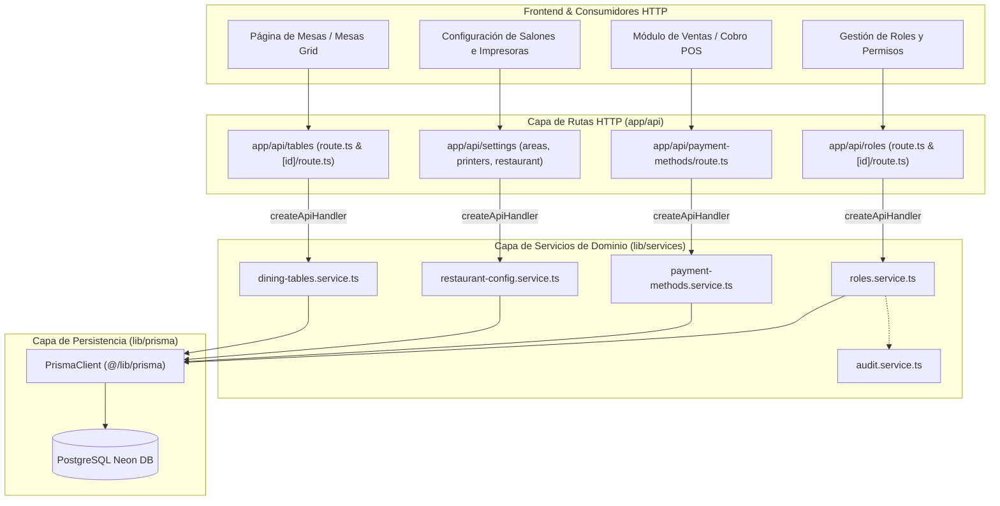

# Feature Specification: Migrar a Arquitectura por Dominio (2/6) - Ajustes y Mesas (Piloto)

**Feature Branch**: `refactor/arquitectura-dominio-ajustes-mesas`  
**Created**: 2026-11-01  
**Status**: In Progress  
**Spec Number**: 045  

---

## 1. Propósito y Resumen

Consolidar la segunda etapa de la migración hacia una **Arquitectura por Dominio** en el backend del ERP Pollería, ejecutando la migración piloto sobre cuatro dominios delimitados y de bajo acoplamiento:
1. **Mesas del Salón (`tables`)**: Gestión de mesas de comensales, capacidades, aforos, estados de ocupación y comandas en curso.
2. **Ajustes y Configuración (`settings`)**: Salones y áreas (`areas`), impresoras y series térmicas (`printers`), identidad comercial y fiscal (`restaurant`), y visualización segura del código QR oficial (`restaurant/qr`).
3. **Métodos de Pago (`payment-methods`)**: Consulta y habilitación de pasarelas y tipos de pago (Efectivo, Tarjeta POS, Yape QR).
4. **Roles y Permisos (`roles`)**: Catálogo de roles, asignación de permisos de acceso (RBAC) y auditoría de seguridad.

### Principio Fundamental
Aplicar de forma estricta la convención unidireccional establecida en la Etapa 1:
$$\text{Route Handler (HTTP)} \longrightarrow \text{Domain Service (Reglas de Negocio)} \longrightarrow \text{Prisma ORM (Persistencia)}$$

Ningún handler bajo `app/api/{tables,settings,payment-methods,roles}` debe importar directamente `@/lib/prisma`. Toda lógica de acceso a datos, validación y cómputo de estado debe residir en sus respectivos servicios de dominio en `lib/services/`.

---

## 2. Escenario y Criterios de Aceptación

### Historia de Usuario
> **Como equipo de desarrollo**, quiero migrar un conjunto acotado de dominios piloto (ajustes, mesas, métodos de pago y roles), para validar el patrón de arquitectura en producción antes de aplicarlo a los dominios críticos (ventas, compras, contabilidad).

### Criterios de Aceptación

1. **Criterio 1: Cero Importaciones de Prisma en Handlers Piloto**
   - Los handlers en:
     - `app/api/tables/route.ts`
     - `app/api/tables/[id]/route.ts`
     - `app/api/settings/areas/route.ts`
     - `app/api/settings/printers/route.ts`
     - `app/api/settings/restaurant/route.ts`
     - `app/api/settings/restaurant/qr/route.ts`
     - `app/api/payment-methods/route.ts`
     - `app/api/roles/route.ts`
     - `app/api/roles/[id]/route.ts`
     no importan `@/lib/prisma`. La regla ESLint `no-restricted-imports` no emite warnings para estas rutas.

2. **Criterio 2: Servicio de Dominio de Mesas (`dining-tables.service.ts`)**
   - Se crea `lib/services/dining-tables.service.ts` con cobertura completa para:
     - Listar mesas con resumen (`total`, `available`, `occupied`, `inactive`), asociación de órdenes activas y cálculo de importes.
     - Crear o reactivar mesas (verificando duplicados y asignando capacidad).
     - Actualizar datos de mesa (validando que el nuevo número no colisione con otra mesa existente).
     - Desactivar mesas mediante soft-delete (`active: false`), bloqueando la desactivación si existen comandas abiertas no cerradas (`notIn: ["Closed", "Cancelled"]`).

3. **Criterio 3: Servicio de Métodos de Pago (`payment-methods.service.ts`)**
   - Se crea `lib/services/payment-methods.service.ts` para encapsular la consulta de `paymentType` filtrando pasarelas activas y configurando capacidades de gateway (`supportsTapToPay`, `supportsQr`).

4. **Criterio 4: Desacoplamiento de Salones y Áreas (`restaurant-config.service.ts`)**
   - `app/api/settings/areas/route.ts` obtiene las áreas enriquecidas con capacidad real mediante la capa de servicios, sin consultar `diningTable` directamente con Prisma en el route handler.

5. **Criterio 5: Estandarización de Handlers con `createApiHandler`**
   - Los handlers migrados utilizan el helper común `createApiHandler` de `lib/http/route-handler.ts`, garantizando:
     - Control de acceso RBAC declarativo.
     - Mapeo consistente de errores (`DomainError`, `NotFoundError`, `ConflictError`, `ValidationError`).
     - Respuestas HTTP estructuradas.

6. **Criterio 6: Pruebas Unitarias y Regresión Cero**
   - Se crean pruebas unitarias completas para los nuevos servicios (`dining-tables.service.test.ts` y `payment-methods.service.test.ts`).
   - Las pruebas unitarias preexistentes (`roles.service.test.ts`, `table-management.test.ts`, `module-settings.test.ts`, `restaurant-config-persistence.test.ts`, `security-permissions.test.ts`) pasan al 100%.
   - La compilación `next build` y `tsc --noEmit` finaliza con código 0.

---

## 3. Diseño Técnico y Arquitectura

### 3.1. Estructura de Capas Resultante

---

## 4. Plan de Verificación

1. **Verificación Estática**:
   - `git grep "import { prisma } from" app/api/tables app/api/settings app/api/payment-methods app/api/roles` debe retornar 0 coincidencias.
2. **Pruebas de Unidad y Servicios Centralizadas en `test/`**:
   - Ejecución de `npx vitest run test/services/` (15 pruebas unitarias de servicios).
   - Ejecución de `npx vitest run test/table-management.test.ts test/restaurant-config-persistence.test.ts test/module-settings.test.ts test/series-comprobantes.test.ts test/security-permissions.test.ts` (135 pruebas de regresión).
3. **Chequeo de Tipos**:
   - `npx tsc --noEmit`.
4. **Verificación de Build**:
   - `npm run build`.
