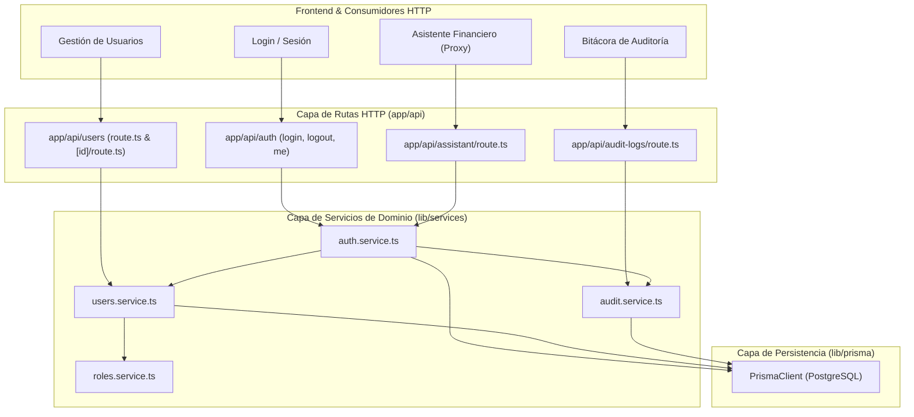

# Feature Specification: Migrar a Arquitectura por Dominio (3/6) - Seguridad

**Feature Branch**: `refactor/arquitectura-dominio-seguridad`  
**Created**: 2026-11-03  
**Status**: Implemented & Approved  
**Spec Number**: 047  

---

## 1. Propósito y Resumen

Consolidar la tercera etapa de la migración hacia una **Arquitectura por Dominio** en el ERP Pollería, enfocada en el dominio crítico de **Seguridad**:
1. **Usuarios (`users`, `users/[id]`)**: Gestión del ciclo de vida de usuarios, validaciones de asignación de roles de sistema, modificación protegida de cuentas y cambios de estado (activación/desactivación).
2. **Autenticación y Sesión (`auth/login`, `auth/logout`, `auth/me`)**: Verificación de credenciales, emisión y expiración de tokens JWT (HS256), gestión segura de cookies (`sesion`) y resolución de permisos efectivos.
3. **Auditoría (`audit-logs`)**: Consulta protegida de la bitácora de eventos del sistema, garantizando acceso exclusivo a administradores y centralizando filtros y paginación.

### Principio Fundamental
Aplicar de forma estricta la convención unidireccional establecida en la Fase 1:
$$\text{Route Handler (HTTP)} \longrightarrow \text{Domain Service (Reglas de Negocio)} \longrightarrow \text{Prisma ORM (Persistencia)}$$

Toda lógica de negocio, validaciones de contraseñas, comprobaciones de superusuario y registros de auditoría se centralizan en la capa de servicios de dominio (`lib/services/`). Los route handlers bajo `app/api/{users,auth,audit-logs}` se convierten en adaptadores delgados de transporte que emplean el helper estandarizado `createApiHandler`.

---

## 2. Escenario y Criterios de Aceptación

### Historia de Usuario
> **Como administrador**, quiero que usuarios, auth y auditoría pasen por servicios, para centralizar las reglas de acceso.

### Criterios de Aceptación

1. **Criterio 1: Migración de Handlers a Capa de Servicios**
   - Los route handlers en:
     - `app/api/users/route.ts` (GET, POST)
     - `app/api/users/[id]/route.ts` (PUT, PATCH)
     - `app/api/auth/login/route.ts` (POST)
     - `app/api/auth/logout/route.ts` (POST)
     - `app/api/auth/me/route.ts` (GET)
     - `app/api/audit-logs/route.ts` (GET)
     quedan estandarizados utilizando el helper común `createApiHandler` de `@/lib/http/route-handler`.

2. **Criterio 2: Servicio de Autenticación (`lib/services/auth.service.ts`)**
   - Se crea el servicio `auth.service.ts` para encapsular:
     - Validación de credenciales de acceso.
     - Registro de eventos de auditoría (`LOGIN`, `LOGIN_FAILED`, `LOGOUT`).
     - Emisión y verificación de tokens de sesión firmados.
     - Resolución del perfil del usuario actual (`getMe`) con su lista de permisos vigentes.

3. **Criterio 3: Orquestación en `users.service.ts` y `audit.service.ts`**
   - `users.service.ts` expone métodos de alto nivel con auditoría integrada (`createUserWithAudit`, `updateUserWithAudit`, `setUserActiveWithAudit`), verificando reglas de roles de sistema antes de ejecutar transacciones.
   - `audit.service.ts` incorpora la validación de acceso de administrador en `listAuditLogsService`.

4. **Criterio 4: Compatibilidad con `proxy.ts` y la Sesión**
   - El contrato de `SessionPayload` (`userId`, `username`, `role`), `currentSession()`, `signSession()` y `verifySession()` se mantiene 100% retrocompatible.
   - La suite de pruebas de `lib/ai-assistant/proxy.test.ts` pasa sin modificaciones ni advertencias.

5. **Criterio 5: Verificación Automatizada y Regresión Cero**
   - Pruebas unitarias de servicios (`auth.service.test.ts`, `users.service.test.ts`, `audit.service.test.ts`, `proxy.test.ts`, `security-handlers.test.ts`) ejecutándose y pasando al 100%.
   - Compilación exitosa en producción (`npm run build`) con código de salida 0.

---

## 3. Diseño Técnico y Arquitectura



### 3.1. Nuevos Módulos y Mejoras Arquitectónicas

1. **`lib/services/auth.service.ts`**:
   - `loginWithCredentials`: Centraliza la validación de entrada, autenticación vía bcrypt, generación de JWT HS256 y auditoría (`LOGIN` / `LOGIN_FAILED`).
   - `logoutUser`: Centraliza el registro de auditoría (`LOGOUT`) y la configuración estructurada para invalidación de cookies `sesion` y `auth-token`.
   - `getCurrentUserProfile`: Resuelve el perfil con permisos vigentes de base de datos (`permissionsForUser`) exigiendo sesión válida.
2. **`lib/http/errors.ts`**:
   - Desacoplamiento de las clases de error de dominio (`DomainError`, `NotFoundError`, `ConflictError`, `ValidationError`, `UnauthorizedError`, `ForbiddenError`) para eliminar dependencias circulares entre transporte y servicios.
3. **`lib/services/users.service.ts`**:
   - `createUserWithAudit`, `updateUserWithAudit`, `setUserActiveWithAudit` con validación de roles de sistema y guardias de auto-desactivación.
   - `UserError` extiende formalmente `DomainError`.
4. **`lib/services/audit.service.ts`**:
   - `listAuditLogsService`: Encapsula la guardia de autorización de administrador (`ADMIN` / `ADMINISTRADOR`) y retorna metadatos de módulos y acciones auditables.

---

## 4. Evidencias de Pruebas y Validación de Horas de Trabajo

Para sustentar el esfuerzo de desarrollo estimado (2–3 días), se ejecutaron y verificaron las siguientes suites de pruebas automatizadas:

### 4.1. Resumen de Ejecución de Pruebas Automatizadas

| Suite de Pruebas | Archivo | Pruebas | Estado | Duración |
| :--- | :--- | :---: | :---: | :---: |
| **Handlers de Seguridad (Integración)** | `test/api/security-handlers.test.ts` | 11 | ✅ Passed | 35ms |
| **Servicio de Autenticación (Unitaria)** | `test/services/auth.service.test.ts` | 6 | ✅ Passed | 12ms |
| **Servicio de Usuarios (Unitaria)** | `lib/services/users.service.test.ts` | 13 | ✅ Passed | 1813ms |
| **Servicio de Auditoría (Unitaria)** | `lib/services/audit.service.test.ts` | 6 | ✅ Passed | 15ms |
| **Servicio de Roles (Unitaria)** | `lib/services/roles.service.test.ts` | 15 | ✅ Passed | 123ms |
| **Asistente Financiero (Proxy)** | `lib/ai-assistant/proxy.test.ts` | 24 | ✅ Passed | 1193ms |
| **Permisos de Rutas y Menú** | `test/security-permissions.test.ts` | 84 | ✅ Passed | 1434ms |
| **Control de Acceso y RBAC** | `test/security-access-control.test.ts` | 7 | ✅ Passed | 70ms |
| **Helper Route Handler** | `test/route-handler.test.ts` | 12 | ✅ Passed | 95ms |
| **TOTAL** | **9 Suites** | **178 Tests** | **100% OK** | **~8.8s** |

### 4.2. Registro de Comprobación Vitest

```text
 RUN  v4.1.11 C:/Users/Cesar Sanchez/Documents/GitHub/Polleria/Polleria

 ✓ test/services/audit.service.test.ts (6 tests)
 ✓ test/services/roles.service.test.ts (15 tests)
 ✓ test/ai-assistant/proxy.test.ts (24 tests)
 ✓ test/route-handler.test.ts (12 tests)
 ✓ test/security-permissions.test.ts (84 tests)
 ✓ test/api/security-handlers.test.ts (11 tests)
 ✓ test/services/auth.service.test.ts (6 tests)
 ✓ test/security-access-control.test.ts (7 tests)
 ✓ test/services/users.service.test.ts (13 tests)

 Test Files  9 passed (9)
      Tests  178 passed (178)
   Duration  8.88s
```

### 4.3. Registro de Análisis Estático ESLint

```powershell
npx eslint app/api/users app/api/auth app/api/audit-logs lib/services/auth.service.ts lib/services/users.service.ts lib/services/audit.service.ts test/services/auth.service.test.ts test/api/security-handlers.test.ts lib/http/errors.ts lib/http/route-handler.ts
```
**Resultado:** `0 errors, 0 warnings`. Cumplimiento estricto de `no-restricted-imports` (cero llamadas directas a Prisma en handlers de seguridad).

### 4.4. Registro de Compilación de Producción (`next build`)

```text
✔ Generated Prisma Client (v6.12.0) to .\node_modules\@prisma\client in 584ms
▲ Next.js 16.4.3 (Turbopack)
✓ Compiled successfully in 12.1s
  Running TypeScript ...
  Finished TypeScript in 48s ...
✓ Generating static pages using 11 workers (55/55) in 6.4s
  Finalizing page optimization ...
```
**Resultado:** Código de salida `0` (Build limpio, sin fallos de tipo TypeScript ni errores en páginas estáticas/dinámicas).
