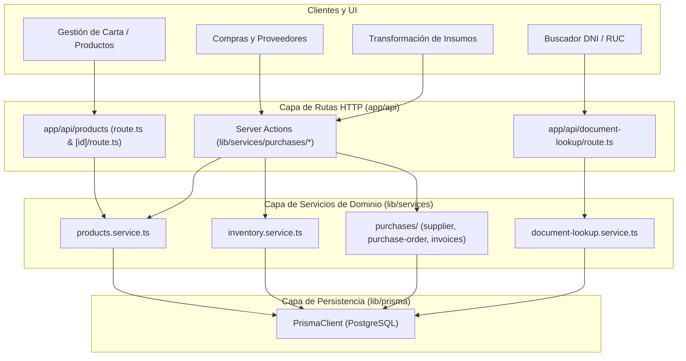

# Feature Specification: Migrar a Arquitectura por Dominio (4/6) - Compras e Inventario

**Feature Branch**: `refactor/arquitectura-dominio-compras-inventario`  
**Created**: 2026-11-04  
**Status**: Implemented  
**Spec Number**: 049  

---

## 1. Propósito y Resumen

Consolidar la cuarta etapa de la migración hacia una **Arquitectura por Dominio** en el ERP Pollería, enfocada en el dominio de **Compras e Inventario**:
1. **Catálogo de Productos y Recetas (`products`, `products/[id]`)**: Gestión unificada de platos para la carta y materias primas, cálculo de stock disponible, precios de venta, costos y formulación de recetas asociadas a insumos.
2. **Consulta de Identidad (`document-lookup`)**: Estandarización del servicio de consulta de DNI y RUC contra la API de `json.pe` con fallback seguro, eliminando la duplicación existente en `lib/services/purchases/document-lookup.ts`.
3. **Inventario, Stock y Transformaciones (`inventory.service.ts`)**: Consolidación de movimientos de almacén (Kardex), registro de mermas, ajustes manuales y transformación de materias primas (ej. pollo entero a piezas marinadas) con transacciones atómicas de Prisma.
4. **Compras y Proveedores (`purchases.service.ts`)**: Integración limpia de órdenes de compra, compras con comprobante (Factura/Boleta) y compras menores sin comprobante, delegando el impacto de stock directamente a la capa de inventario.

### Principio Fundamental
Aplicar de forma estricta la convención unidireccional de capas:
$$\text{Route Handler / Server Action (HTTP)} \longrightarrow \text{Domain Service (Reglas de Negocio)} \longrightarrow \text{Prisma ORM (Persistencia)}$$

---

## 2. Escenario y Criterios de Aceptación

### Historia de Usuario
> **Como encargado de compras**, quiero que proveedores, compras, stock y transformaciones tengan una sola capa de lógica, para evitar duplicar reglas de inventario.

### Criterios de Aceptación

1. **Criterio 1: Consolidación de Handlers HTTP a `createApiHandler`**
   - Los route handlers en:
     - `app/api/products/route.ts` (GET, POST)
     - `app/api/products/[id]/route.ts` (GET, PUT, PATCH, DELETE)
     - `app/api/document-lookup/route.ts` (GET, POST)
     quedan desacoplados de Prisma mediante el helper común `createApiHandler` de `@/lib/http/route-handler`.

2. **Criterio 2: Servicio Unificado de Productos (`lib/services/products.service.ts`)**
   - Expone métodos para:
     - `listProducts(filter)`: Búsqueda por texto, categoría, estado (`active`), vendible (`sellable`) y carga opcional de recetas.
     - `getProductById(id)`: Obtención de producto con detalle de receta e insumos.
     - `createProduct(data)`: Validación de reglas (precio obligatorio si es vendible, nombre único, unidad de medida).
     - `updateProduct(id, data)`: Edición de campos generales y recetas.
     - `setProductActive(id, active)`: Activación o pausa en carta.
     - `deleteProduct(id)`: Baja lógica sin pérdida de integridad referencial.

3. **Criterio 3: Servicio Unificado de Documentos (`lib/services/document-lookup.service.ts`)**
   - Eliminar duplicación entre `document-lookup.service.ts` y `purchases/document-lookup.ts`.
   - Soporte para validación previa de formato peruano (DNI de 8 dígitos, RUC de 11 dígitos con dígitos iniciales 10, 15, 17, 20).
   - Manejo de timeout y modo fallback resiliente.

4. **Criterio 4: Servicio de Inventario y Movimientos (`lib/services/inventory.service.ts`)**
   - Manejo centralizado de transacciones atómicas:
     - `recordMovement(tx, movementData)`: Registro en `InventoryMovement` y actualización de `currentStock`.
     - `executeTransformation(data)`: Descuento del insumo origen y aumento de los productos destino en una única transacción `$transaction`.
     - `adjustStock(productId, newStock, reason)`: Ajuste auditado de stock.

5. **Criterio 5: Verificación Automatizada y Regresión Cero**
   - Pruebas unitarias completas en el directorio `test/` (`test/services/products.service.test.ts`, `test/services/inventory.service.test.ts`, `test/api/products-handlers.test.ts`, `test/api/document-lookup-handler.test.ts`).
   - El 100% de la suite de pruebas del proyecto pasa en verde.
   - ESLint con 0 errores y 0 warnings (regla `no-restricted-imports` sobre `@/lib/prisma` en `app/`).
   - Compilación en producción `npm run build` con código de salida 0.

---

## 3. Diagrama de Arquitectura

