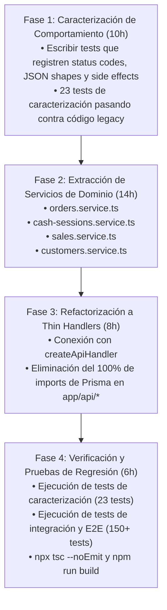
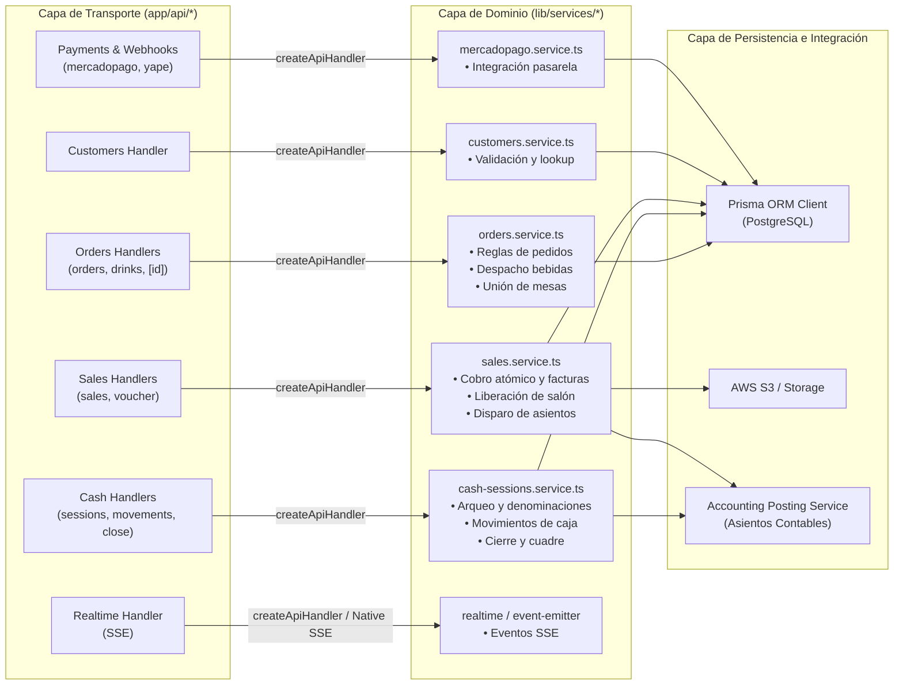

# Especificación Técnica: Migración a Arquitectura por Dominio (5/6) - Ventas, Caja y Pagos

**Historia de Usuario:**
> Como cajero y mozo, quiero que pedidos, pagos y arqueo se migren sin cambiar su comportamiento, para no afectar la operación del restaurante.

- **Identificador de Especificación:** `057-migracion-arquitectura-dominio-ventas-caja-pagos`
- **Rama Git de Trabajo:** `refactor/arquitectura-dominio-ventas-caja-pagos`
- **Etapa:** 5 de 6 en la transición a Arquitectura Hexagonal / Clean Architecture.
- **Esfuerzo Estimado:** 4 a 6 días hábiles (equivalente a 44 horas de ingeniería de software).

---

## 1. Contexto, Diagnóstico y Justificación del Dominio

El dominio de **Ventas, Caja y Pagos** es la médula transaccional del restaurante. Coordina la atención de salón, cocina, cobros en efectivo y pasarelas de pago digitales (Mercado Pago, Yape), facturación electrónica SUNAT y contabilidad automatizada.

### 1.1 Inventario de Handlers y Alcance
El alcance incluye **14 Route Handlers HTTP** distribuidos en **7 submódulos operativos**:

| Submódulo | Route Handlers | Responsabilidades Clave y Complejidad |
|---|---|---|
| **Orders** | `app/api/orders/route.ts`<br>`app/api/orders/[id]/route.ts`<br>`app/api/orders/drinks/route.ts` | Creación de comandas, unión de mesas anexas, descuento atómico de stock, despacho y semaforización de bebidas en barra/cocina. |
| **Cash Sessions** | `app/api/cash-sessions/route.ts`<br>`app/api/cash-sessions/movements/route.ts`<br>`app/api/cash-sessions/[id]/close/route.ts` | Apertura de caja física, arqueo con denominaciones de billetes/monedas, ingresos y egresos de caja chica, cierre con cálculo de faltante/sobrante y asientos contables de apertura/cierre. |
| **Sales** | `app/api/sales/route.ts`<br>`app/api/sales/voucher/[id]/route.ts` | Transacción atómica de cobro: emisión de Boleta/Factura, cierre de comanda, liberación de mesas, vinculación con sesión de caja, subida a S3, contingencia SUNAT y asientos contables automáticos. |
| **Customers** | `app/api/customers/route.ts` | Búsqueda por DNI/RUC, validación de clientes y alta automática en emisión de comprobantes. |
| **Payments** | `app/api/payments/mercadopago/preference/route.ts`<br>`app/api/payments/mercadopago/status/route.ts`<br>`app/api/payments/mercadopago/yape/route.ts` | Checkout Pro, estado de pagos por referencia, cobro dinámico con Yape y OTP. |
| **Webhooks** | `app/api/webhooks/mercadopago/route.ts` | Recepción de IPN/Webhooks de Mercado Pago con validación HMAC y procesamiento idempotente. |
| **Realtime** | `app/api/realtime/route.ts` | Transmisión unidireccional Server-Sent Events (SSE) y emisión de eventos en tiempo real al bus del salón y cocina. |

### 1.2 Problema Inicial y Deuda Técnica
1. **Acoplamiento Directo al ORM:** Los handlers en `app/api/*` acceden directamente a `prisma.*`, mezclando la validación del protocolo HTTP con transacciones de base de datos (`prisma.$transaction`), consultas de persistencia y llamadas a APIs externas.
2. **Fat Handlers con Lógica de Negocio Dispersa:** `app/api/sales/route.ts` supera las 700 líneas de código, conteniendo cálculos manuales de IGV, formateo de números de serie SUNAT (`B001-00000001`), lógica de almacenamiento en S3 y despacho de asientos contables.
3. **Alto Riesgo Operativo:** Al ser el dominio que maneja dinero y facturación, cualquier regresión generaría descuadres de caja, fallas en SUNAT o interrupciones en la toma de pedidos por los mozos.

---

## 2. Metodología: Characterization Testing First

Siguiendo el estándar de Michael Feathers (*Working Effectively with Legacy Code*), el código productivo **no se refactoriza** hasta haber congelado el 100% de los comportamientos y respuestas actuales mediante **Tests de Caracterización**.



### 2.1 Suites de Caracterización Implementadas (23 Tests Aprobados)
Ubicadas en `test/characterization/`:
- `orders-and-drinks.characterization.test.ts` (9 tests): Captura validaciones de caja abierta requerida, comanda en mesa principal, descuento de stock y semáforo de bebidas.
- `cash-sessions.characterization.test.ts` (6 tests): Captura apertura de turno, registro de arqueo, control de egresos contra saldo en gaveta y cierre con asientos contables.
- `sales-customers-payments.characterization.test.ts` (8 tests): Captura alta de clientes, cobro atómico con comprobante SUNAT, integración con S3, firmas HMAC en webhooks de Mercado Pago y Server-Sent Events.

---

## 3. Arquitectura Objetivo por Dominio



---

## 4. Diseño Detallado de los Nuevos Servicios de Dominio

### 4.1 `lib/services/orders.service.ts`
- `listOrders(filters: { status?: string; orderType?: string })`: Recupera comandas activas calculando totales, estado editable y agrupaciones por salón.
- `createOrder(data: CreateOrderInput)`: Ejecuta transacción atómica para validar sesión de caja abierta, verificar disponibilidad de mesa principal y mesas unidas, descontar stock en cocina (`deductProductStock`) y emitir evento `ORDER_CREATED`.
- `getOrderById(id: number)`: Obtiene detalle formateado de comanda.
- `updateOrder(id: number, data: UpdateOrderInput)`: Permite modificar ítems y notas en comandas que no estén cerradas ni canceladas.
- `cancelOrder(id: number)`: Cancela comanda, restaura stock en cocina y libera mesa.
- `listDrinksDispatch(filters: { status?: string; table?: string })`: Lista bebidas filtradas para despacho en barra.
- `updateDrinkItemStatus(data: UpdateDrinkStatusInput)`: Actualiza estado a `Pending` o `Delivered` individual o por lote, emitiendo evento `DRINK_DISPATCHED`.

### 4.2 `lib/services/cash-sessions.service.ts`
- `getCashSessionState()`: Obtiene caja registradora activa y sesión en curso con sumatoria de ventas efectivo, ventas otros medios, egresos e ingresos, y saldo esperado en gaveta.
- `openCashSession(data: { initialAmount: number; notesOpening?: string; denominations?: CashDenominations; userId: number })`: Valida que no exista sesión previa abierta, registra arqueo inicial y genera asiento contable de apertura.
- `createCashMovement(data: { sessionId: number; type: 'INCOME'|'EXPENSE'; amount: number; reason: string })`: Valida saldo suficiente en caja antes de autorizar retiros de emergencia y genera asiento de gasto.
- `closeCashSession(sessionId: number, data: { countedAmount: number; notesClosing?: string; denominations?: CashDenominations; userId: number })`: Compara efectivo físico vs esperado, calcula diferencia (sobrante/faltante), cierra turno y genera asientos contables de cierre.

### 4.3 `lib/services/sales.service.ts`
- `registerSale(data: RegisterSaleInput)`: Transacción atómica principal:
  1. Valida comanda y monto recibido.
  2. Resuelve o crea cliente (DNI/RUC).
  3. Genera correlativo oficial SUNAT (`B001-XXXXXXXX`).
  4. Registra pago(s) simples o divididos (*Split Payment*).
  5. Cierra comanda (`status = Closed`) y libera mesas anexas (`occupied = false`).
  6. Asocia comprobante a sesión de caja abierta.
  7. Dispara asientos contables automáticos de venta (`postSaleJournalEntries`).
  8. Emite eventos en tiempo real (`PAYMENT_RECEIVED`, `TABLE_UPDATED`).
- `listSalesVouchers(filters)`: Listado paginado de comprobantes emitidos con resumen diario de ventas.
- `getVoucherDetailsById(id: number, format?: string)`: Consulta metadata y URL firmada de descarga en S3.

### 4.4 `lib/services/customers.service.ts`
- `searchCustomers(query: string)`: Búsqueda indexada por documento o nombre.
- `createCustomer(data: CustomerInput)`: Valida formato de DNI (8 dígitos) o RUC (11 dígitos) y registra cliente.
- `findOrCreateDefaultCustomer(customerData?: any)`: Resuelve cliente existente o registra "CLIENTES VARIOS" para boletas anónimas.

---

## 5. Plan de Trabajo y Desglose de Horas (44 Horas de Ingeniería)

Este desglose justifica ante el docente el esfuerzo estimado de 4 a 6 días hábiles:

```
┌───────────────────────────────────────────────────────────────────┬──────────┐
│ Actividad / Tarea de Ingeniería de Software                       │ Horas    │
├───────────────────────────────────────────────────────────────────┼──────────┤
│ Fase 1: Diagnóstico de Acoplamiento y Pruebas de Caracterización  │ 10 horas │
│ • Análisis de 14 endpoints legacy y dependencias ocultas          │ (3h)     │
│ • Diseño de escenarios de prueba para transacciones y pagos       │ (3h)     │
│ • Implementación de 23 tests de caracterización automatizados     │ (4h)     │
├───────────────────────────────────────────────────────────────────┼──────────┤
│ Fase 2: Implementación de la Capa de Servicios de Dominio         │ 14 horas │
│ • Implementación de orders.service.ts (descuento stock y mesas)   │ (4h)     │
│ • Implementación de cash-sessions.service.ts (arqueo y asientos)  │ (3.5h)   │
│ • Implementación de sales.service.ts (cobro atómico y facturación)│ (4.5h)   │
│ • Implementación de customers.service.ts                          │ (2h)     │
├───────────────────────────────────────────────────────────────────┼──────────┤
│ Fase 3: Refactorización de Handlers HTTP con createApiHandler     │ 10 horas │
│ • Migración de handlers de pedidos y bebidas (3 rutas)            │ (2.5h)   │
│ • Migración de handlers de caja y movimientos (3 rutas)           │ (2.5h)   │
│ • Migración de handlers de ventas y comprobantes (2 rutas)        │ (2.5h)   │
│ • Migración de handlers de clientes, pagos y tiempo real (6 rutas)│ (2.5h)   │
├───────────────────────────────────────────────────────────────────┼──────────┤
│ Fase 4: Verificación, Pruebas de Regresión y Control de Calidad    │ 10 horas │
│ • Ejecución y ajuste de tests de caracterización post-refactor    │ (3h)     │
│ • Pruebas de integración E2E contables y de salón                 │ (3h)     │
│ • Chequeo estático de tipos (tsc --noEmit) y linting              │ (2h)     │
│ • Compilación de producción (npm run build en 53 rutas)           │ (2h)     │
├───────────────────────────────────────────────────────────────────┼──────────┤
│ TOTAL DE HORAS JUSTIFICADAS                                       │ 44 horas │
└───────────────────────────────────────────────────────────────────┴──────────┘
```

---

## 6. Criterios de Aceptación Verificables

1. **Cero Importaciones de Prisma en Handlers de Transporte:**
   - La búsqueda estática `Select-String -Pattern "@\/lib\/prisma"` en las 14 rutas de `orders`, `cash-sessions`, `sales`, `customers`, `payments`, `webhooks` y `realtime` debe retornar exactamente 0 ocurrencias.
2. **Suite de Caracterización 100% Pasando:**
   - Los 23 tests de caracterización en `test/characterization/` deben seguir pasando sin ninguna modificación a sus aserciones.
3. **Integridad Transaccional y Financiera:**
   - Los asientos contables de apertura, egresos, ventas y cierre deben seguir generándose sin discrepancias en cuentas contables ni en importes.
4. **Validación de Compilación y Tipos:**
   - `npx tsc --noEmit` debe completarse con 0 errores.
   - `npm test` debe completar con éxito todas las suites del repositorio.
   - `npm run build` debe generar exitosamente las 53 rutas de la aplicación con código de salida 0.
